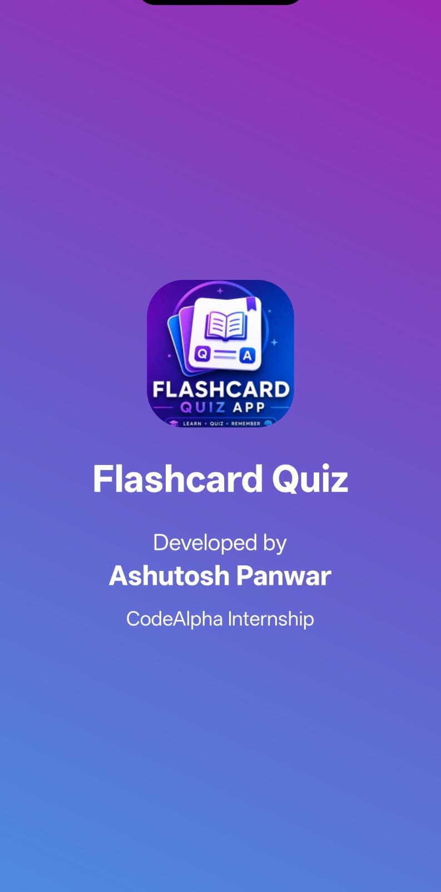
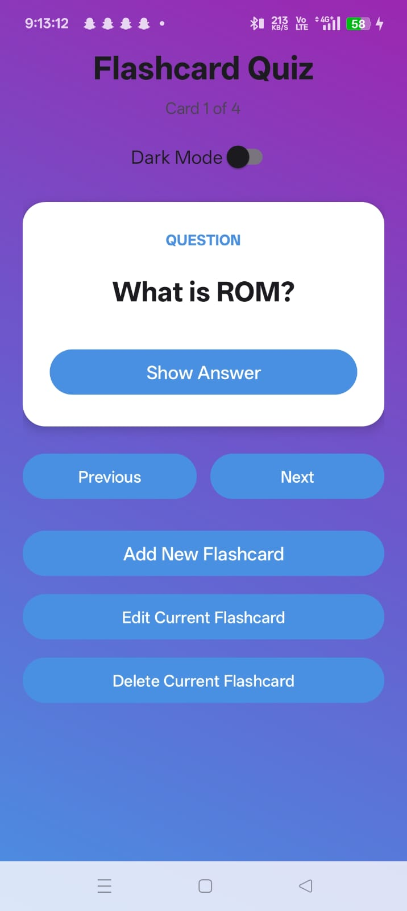
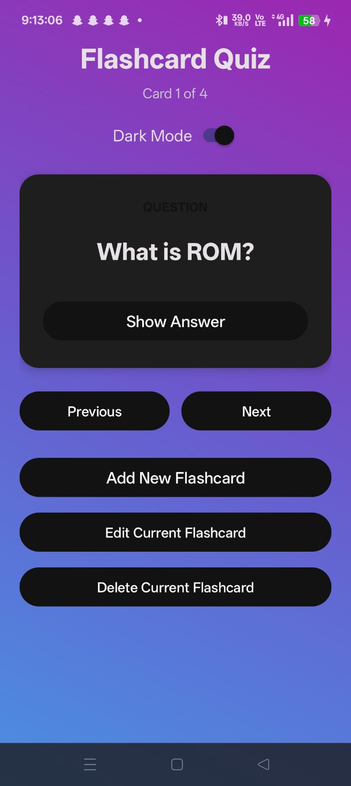
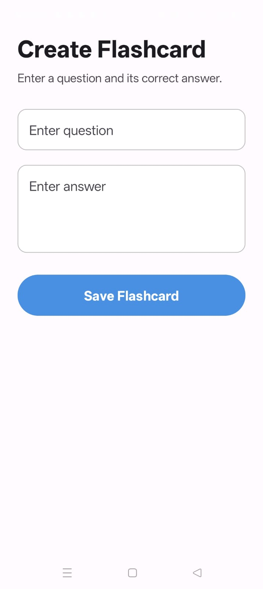
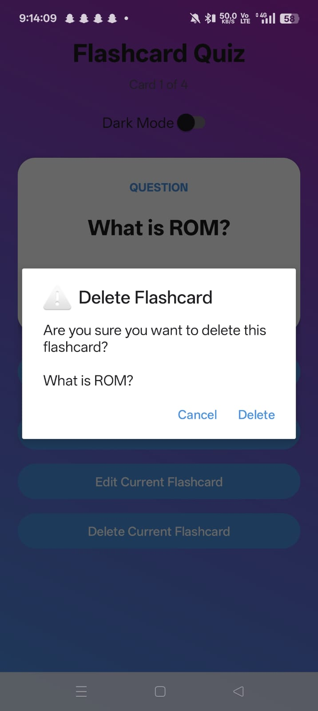

# 📚 Flashcard Quiz App

An interactive **Android Flashcard Quiz App** developed as part of the **CodeAlpha Internship**.

The application allows users to create, manage, edit, delete, and review flashcards through a clean and simple Android interface. It supports persistent local storage using SQLite and includes both light and dark mode.

## ✨ Features

- Create new flashcards
- View saved flashcards
- Edit existing flashcards
- Delete flashcards with confirmation
- Show/Hide flashcard answers
- Previous and Next flashcard navigation
- SQLite database for local data storage
- Dark Mode support
- Material Design based UI
- Splash Screen
- Clean and user-friendly interface

## 🛠️ Tech Stack

- **Java**
- **Android Studio**
- **SQLite**
- **Material Design**
- **Gradle**

## 📂 Project Structure

```text
CodeAlpha_FlashcardQuizApp/
├── app/
├── gradle/
├── add-flashcard.jpeg
├── dark-mode.jpeg
├── delete-dialog.jpeg
├── light-mode.jpeg
├── splash.jpeg
├── build.gradle.kts
├── gradle.properties
├── gradlew
├── gradlew.bat
├── settings.gradle.kts
└── README.md
```

## 🚀 Installation

### 1. Clone the repository

```bash
git clone https://github.com/PhaseDev6/CodeAlpha_FlashcardQuizApp.git
```

### 2. Open the project

Open **Android Studio** and select **Open an Existing Project**.

Then select the cloned `CodeAlpha_FlashcardQuizApp` folder.

### 3. Sync Gradle

Allow Android Studio to complete the Gradle synchronization.

### 4. Run the application

Connect an Android device or start an emulator and click **Run**.

## 📸 Screenshots

### Splash Screen



### Main Screen - Light Mode



### Main Screen - Dark Mode



### Add Flashcard



### Delete Confirmation Dialog



## 💡 Key Learning Outcomes

Through this project, I strengthened my understanding of:

- Android application development using Java
- SQLite database integration
- CRUD operations
- Android Activity and UI lifecycle
- Material Design principles
- Dark and Light theme implementation
- Local data persistence
- User input handling and validation
- Debugging and application testing
- Git and GitHub version control

## 🎯 Internship Project

This project was developed as part of my **CodeAlpha Internship**, with a focus on practical Android development and implementing useful real-world application features.

## 👨‍💻 Developed By

**Dhruv Chamola**

CodeAlpha Internship Project

## 📄 License

This project is developed for educational, learning, and internship purposes.
